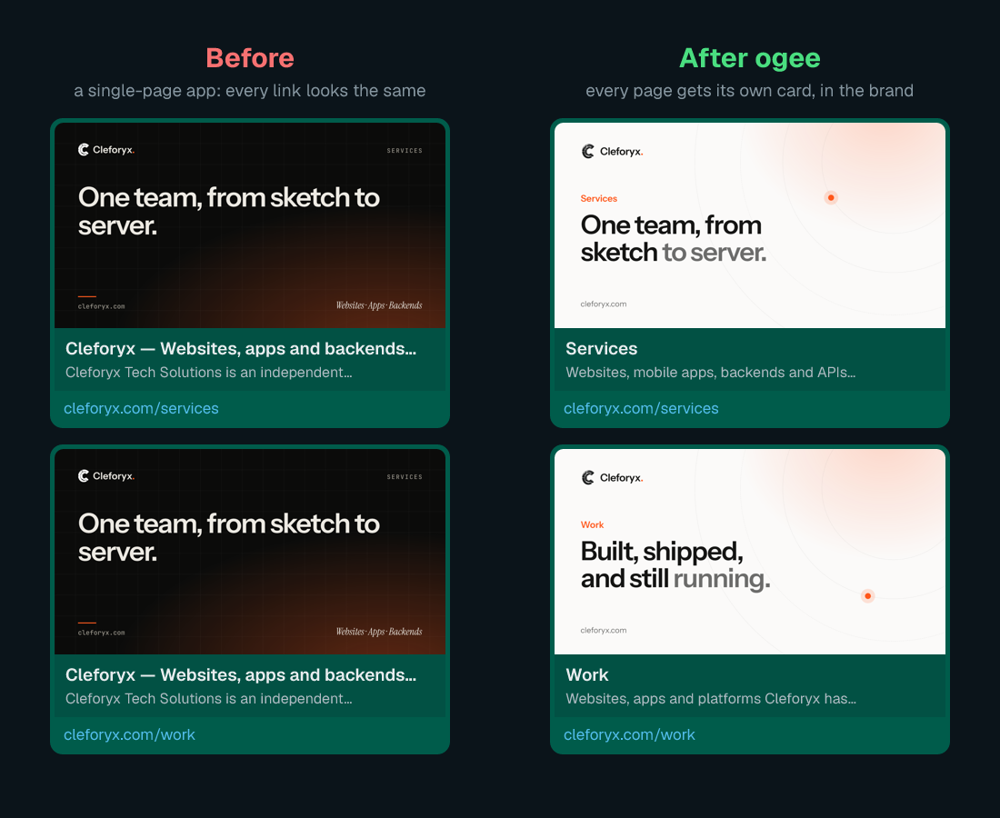
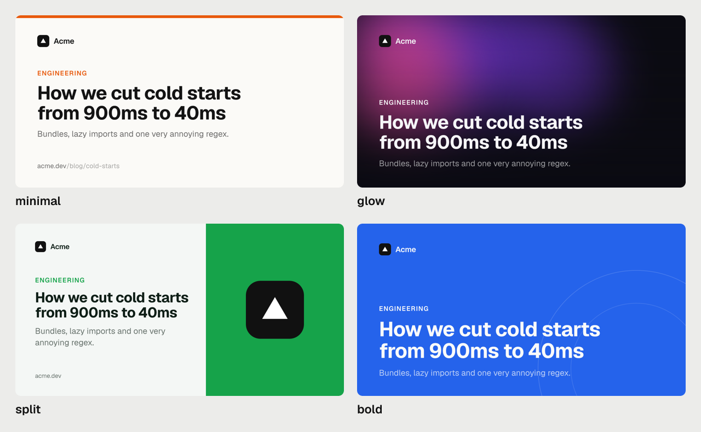

<div align="center">

# ogee

**Link previews for single-page apps, drawn at the edge.**

Every page gets its own title, description and a preview card in your brand,<br>
on WhatsApp, X, LinkedIn, Slack, iMessage, Discord, Google and AI search.

[](https://www.npmjs.com/package/ogee)
[](https://github.com/virus-dev-official/ogee/actions/workflows/ci.yml)
[](LICENSE)

<sub><i>ogee</i> (oh-jee): <b>OG</b> at the <b>edge</b>. Also the S-shaped curve on old arches.</sub>



</div>

## The problem

Apps built with React, Vue, Svelte or Vite, and anything made with Lovable, Bolt or v0, send **the same
`index.html` for every URL**. The bots behind link previews and AI search don't run JavaScript, so they
only ever see that one file. Share `/pricing`, `/blog/my-post` or `/products/42` and they all show your
home page's preview, or nothing at all.

Check any link in five seconds:

```bash
npx ogee check https://your-site.com/some-page
```

```
  ✓ og:title      "Acme — ship faster"
  ✓ og:image      1200×630 · png · 106 KB
  ✗ spa           This page has the same preview as the home page. It's a single-page app:
                  every link to this site looks identical.

  Preview score: 4/10
```

## The fix

ogee is a small [Cloudflare Worker](https://developers.cloudflare.com/workers/) that sits in front of your
site. For every page it:

- writes the right `<title>`, description, canonical URL, Open Graph and Twitter tags, and JSON-LD
- **draws a preview card for that page** in your colors, fonts and logo, with the page's own picture
  (product photo, cover, screenshot) when it has one. In milliseconds, then cached
- serves `/sitemap.xml` and [`/llms.txt`](https://llmstxt.org) for search engines and AI tools
- optionally writes the page's text into the HTML, so crawlers see words, not an empty `<div id="root">`

You don't change your app, your build or your host. If anything goes wrong, the page is served exactly as
before.

## Quick start

```bash
npx ogee init https://your-site.com
```

`init` opens your site in a headless browser and reads what's already there: your **colors** (including
shadcn/Tailwind `--primary` tokens), your **fonts** (downloaded from your site or Google Fonts), your
**logo**, and your **pages** with their real headlines. It writes an `ogee/` folder:

```
ogee/
  ogee.config.ts    your pages and brand, all editable
  worker.ts         three lines
  wrangler.toml     where it runs
  assets/           logo.png, fonts/
```

Then:

```bash
cd ogee
npx ogee render     # draws every card into .ogee/cards/, with a gallery page to look at
npx ogee dev        # runs the Worker locally in front of your live site
npx ogee deploy     # puts it live
```

## Built for coding agents

ogee doesn't ask for an AI API key. **The coding agent you already use is the designer.** ogee collects the
evidence and renders whatever the agent writes, and the agent looks at the result and fixes it.

Tell Claude Code, Cursor, Codex or any agent:

> Run `npx ogee inspect --for-agent` and make our link previews look great.

`inspect` saves screenshots of your site (desktop and phone), the brand values it found, the cards as they
look now, and an `AGENT.md` with the whole workflow. The agent writes a template that matches your site's
signature look, runs `npx ogee render --json`, opens every PNG, and keeps going until they're right.
Every command takes `--json`.

For Claude Code, install the skill once:

```bash
npx ogee skill
```

## Cards

Four built-in templates, colored by your brand:



Or write your own. A template is a function that returns HTML:

```ts
// templates/brand.ts
import { esc, fitTitle, type Template } from "ogee";

export const brand: Template = (card) => `
<div style="display:flex;flex-direction:column;justify-content:flex-end;width:100%;height:100%;
            padding:72px;background:${card.colors.background}">
  <div style="font-family:'${card.headingFont}';font-size:${fitTitle(card.title)}px;
              color:${card.colors.foreground};text-wrap:balance">${esc(card.title)}</div>
</div>`;
```

Cards are drawn by [takumi](https://github.com/kane50613/takumi), which runs in the Worker as WebAssembly:
flexbox, gradients, `filter: blur()`, blend modes, masks, clip paths, SVG filters (film grain!), custom
fonts, and no headless browser. Each page gets a stable `card.seed`, so generative backgrounds differ per
page but never between renders.

**Designs the renderer can't draw** (WebGL, `backdrop-filter`, layered photography) become a *plate*: write
the background as an HTML file and `npx ogee plate plate.html` renders it once with a real browser. The
text is still drawn per page on top.

Missing glyphs never show up as boxes: `init` adds a tiny fallback font (≈6 KB) with currency signs like
₵ ₦ € £ and letters like ɛ ɔ ŋ, plus anything else your site uses.

## Product photos, covers and screenshots

A card for a product, a post or a portfolio piece should show *that thing*. Give a page an `image` and the
built-in templates frame it beside the title: tall frames for flyers and phone screens, wide ones for
photos and screenshots.

`init` finds these for you. For each page it picks the main picture (the biggest one near the top that
isn't the logo; grids of thumbnails don't count). If a page already sets its own designed preview card
after JavaScript runs, `init` keeps it as `ogImage`, and ogee makes sure bots finally see it.

## Pages from your data

```ts
// ogee.config.ts
import { defineConfig } from "ogee";

export default defineConfig({
  site: "https://acme.dev",
  name: "Acme",
  titleTemplate: "%s · Acme",
  brand: {
    logo: "logo.svg",
    colors: { background: "#0b0b12", foreground: "#f5f5f7", accent: "#7c3aed" },
  },
  card: { template: "glow" },
  routes: {
    "/": { title: "Acme — ship faster", description: "Tools for people who ship." },
    "/pricing": { title: "Pricing", ogTitle: "Plans from $0", eyebrow: "Pricing" },

    // Return null for records that don't exist; { status: 404 } to say so to crawlers.
    "/blog/:slug": async ({ params, fetch }) => {
      const r = await fetch(`https://api.acme.dev/posts/${params.slug}`);
      if (!r.ok) return null;
      const post = await r.json();
      return { title: post.title, description: post.excerpt, image: post.cover, eyebrow: "Blog" };
    },
  },
  // Lets the sitemap and llms.txt list every post too.
  sitemap: { paths: async ({ fetch }) => (await (await fetch("https://api.acme.dev/posts")).json()).map((p) => `/blog/${p.slug}`) },
});
```

Route lookups are cached at the edge (`cacheTtl`, 5 minutes by default) and have a 3-second timeout:
a slow API never slows the page down.

<details>
<summary><b>Everything a page can say</b></summary>

| Field | What it does |
|---|---|
| `title` | The `<title>`, with `titleTemplate` applied (not on the home page) |
| `ogTitle` | Title for previews and the card, if it should differ |
| `description` | Meta, Open Graph and Twitter description |
| `eyebrow` | Small label above the title on the card |
| `image` | The page's own photo; templates like `split` show it |
| `ogImage` | A finished preview image URL; skips drawing a card |
| `template` | A different card template for this page |
| `data` | Anything your own template wants (`card.data`) |
| `type` | `og:type`, default `website` |
| `canonical` | Override the canonical URL |
| `noindex` | Keep it out of search results |
| `status` | `404` or `410` for missing records |
| `jsonLd` | Extra JSON-LD objects |
| `html` | Text written into `#root` for crawlers; your app replaces it on load |
| `hidden` | Leave it out of the sitemap and llms.txt |

</details>

<details>
<summary><b>Site options</b></summary>

| Option | |
|---|---|
| `site` | Your public URL |
| `origin` | Where pages really come from, if the Worker isn't in front of the site on the same hostname |
| `name`, `description`, `titleTemplate`, `locale`, `twitter` | Site-wide defaults |
| `brand` | `logo`, `colors` (`background`, `foreground`, `accent`, `accent2`, `muted`), `fonts`, `headingFont`, `bodyFont`, `headingWeight`, `plate` |
| `card` | `template`, `format` (`"png"` or `"jpeg"`), `quality`, `width`, `height` |
| `templates` | Your own templates by name |
| `routes` | Pages by pattern: `/pricing`, `/blog/:slug`, `/docs/*` |
| `unmatched` | `"defaults"` (site defaults for unknown paths) or `"passthrough"` |
| `trailingSlash` | Your URLs end in `/`; `init` detects this |
| `mount` | Where `page.html` goes; default `#root, #app` |
| `sitemap`, `llms` | Turn them off, or add `sitemap.paths` |
| `cacheTtl` | Seconds to cache lookups and cards; default 300 |

</details>

## Where it runs

**Your domain is already on Cloudflare** (proxied, orange cloud): ogee runs on a route in front of it. Nothing
else changes. This is the default `init` setup.

**Your app lives somewhere else** (Lovable, Vercel, Netlify, GitHub Pages…): put your domain on Cloudflare,
point it at the Worker, and tell ogee where the pages come from:

```bash
npx ogee init https://acme.dev --origin https://acme.lovable.app
```

The Cloudflare free plan covers 100,000 Worker requests a day. On a route, every request to your site
passes through the Worker (scripts and images too, untouched), so they all count. Cards are drawn once and
then served from cache.

## FAQ

**Why not just use Next.js or Astro?** If you can, server rendering solves this too. ogee is for the
millions of apps that are already single-page apps, and for people who don't control the framework.

**Does it slow my site down?** Barely. The page and its route lookup are fetched at the same time, and the
`<head>` is rewritten as the HTML streams through. Fixed routes add nothing; a route that calls your API
adds whatever that call takes beyond the page fetch (cached for 5 minutes, capped at 3 seconds). Cards are
drawn on demand in milliseconds and then cached, and their URLs change when the card does, so apps pick up
new versions.

**What if my API is down?** The page is served unchanged after 3 seconds at most. ogee never breaks a page.

**Does every visitor get the rewritten HTML?** Yes, people and bots alike: it's the same app with a better
`<head>`, which is what search engines expect.

**Can I see what a page will say?** `npx ogee meta /pricing` prints its tags.

## Commands

| | |
|---|---|
| `ogee check <url>` | Grade a link's preview and explain what's wrong |
| `ogee init <url>` | Set up: brand, logo, fonts, pages |
| `ogee inspect [url] --for-agent` | Screenshots and brand data for a coding agent |
| `ogee render [paths…]` | Draw cards into `.ogee/cards/`, with a gallery |
| `ogee plate <file.html>` | Render a background image with a real browser |
| `ogee meta <path>` | Print the tags for one page |
| `ogee dev` | Run the Worker locally in front of your live site |
| `ogee deploy` | Deploy with wrangler |
| `ogee skill` | Install the Claude Code skill |

## Contributing

```bash
npm install
npm test              # unit tests
npm run build
npm run test:e2e      # the Worker in the real Workers runtime, in front of a test app
```

Issues and pull requests are welcome, especially new built-in templates.

## Releases

Every version on npm is built and published by [GitHub Actions](.github/workflows/release.yml) from a
tagged commit in this repo, never from someone's laptop. npm records where each version came from:
the **Provenance** section on [the npm page](https://www.npmjs.com/package/ogee) links to the exact commit
and build. Check it from the command line with `npm audit signatures`.

## License

MIT. Card rendering by [takumi](https://github.com/kane50613/takumi).
